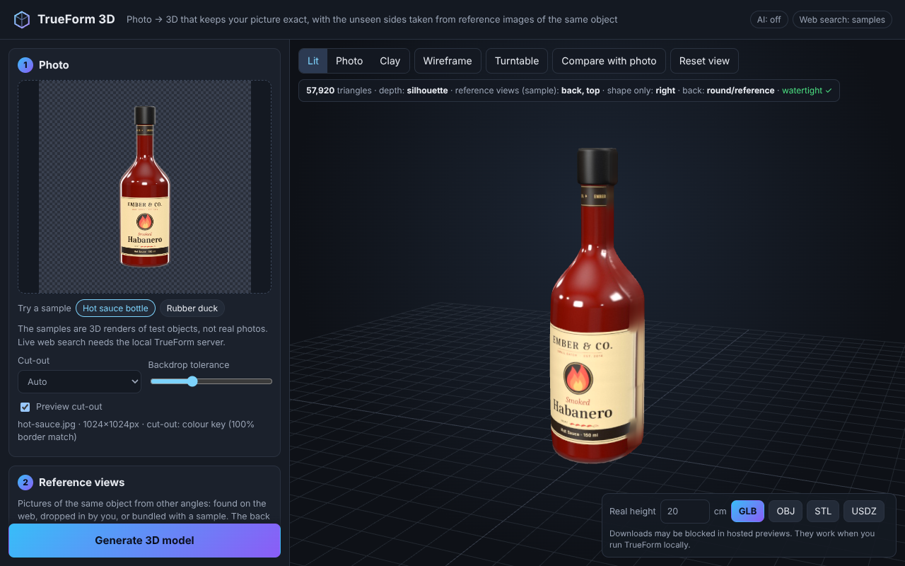
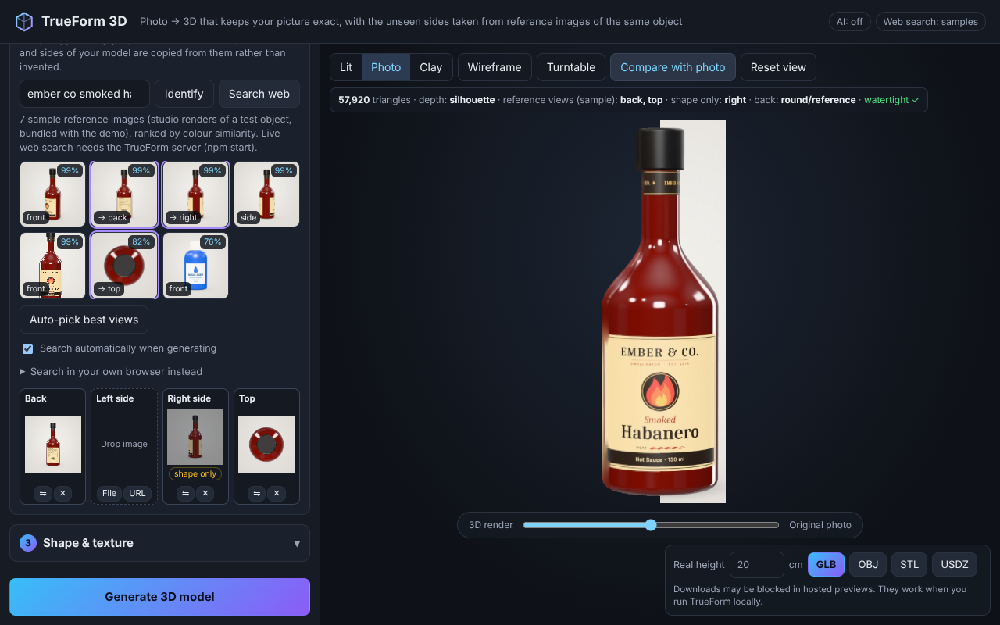
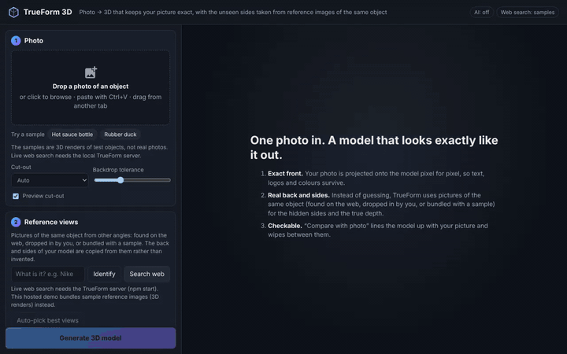
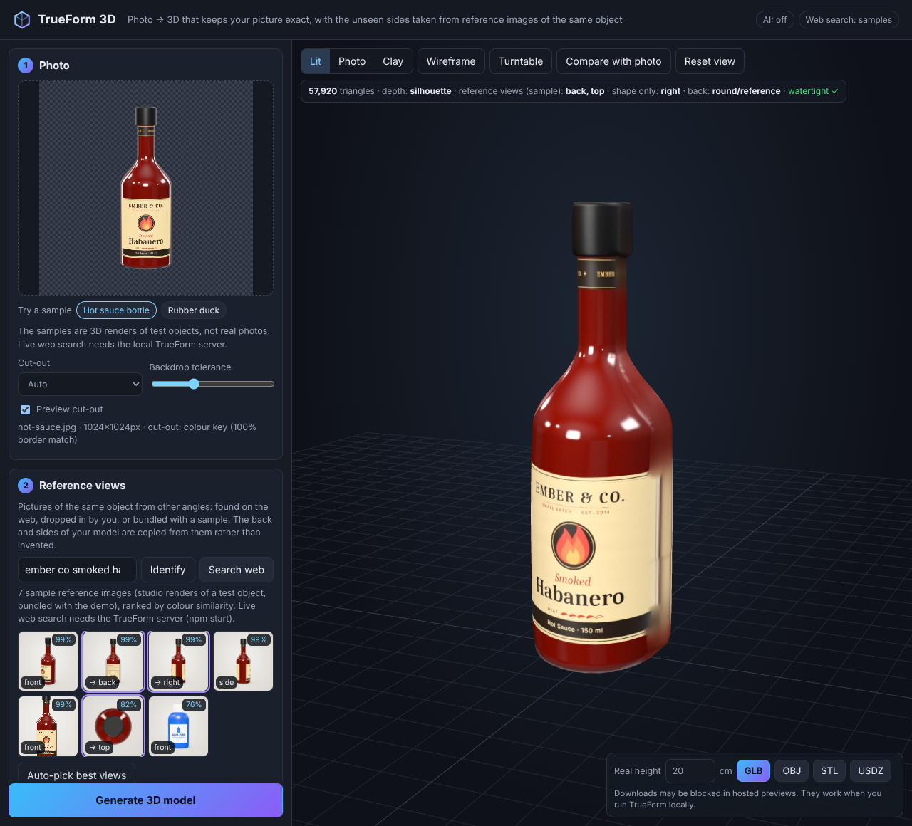
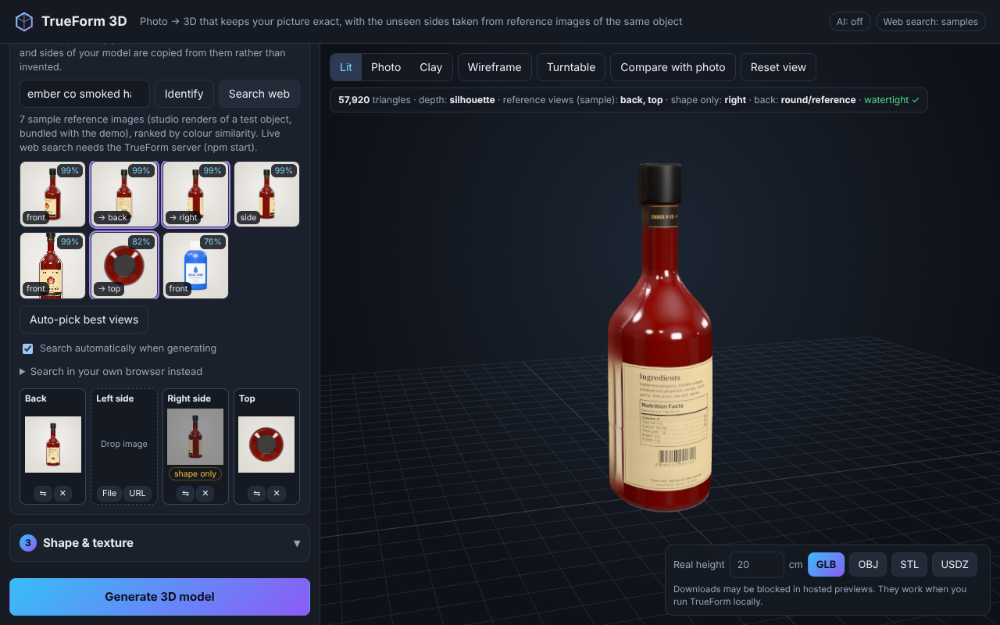
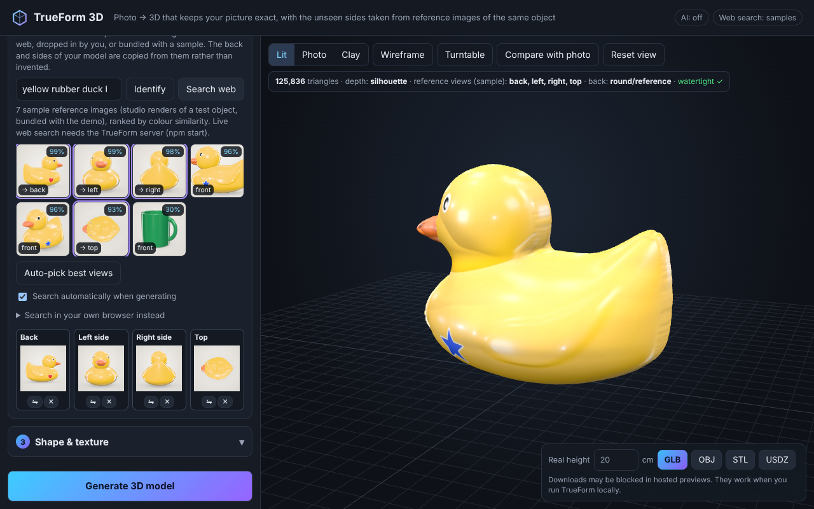
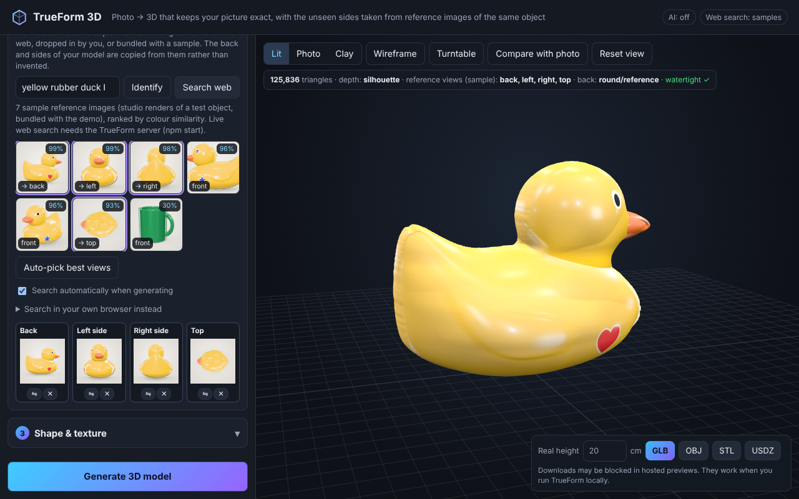
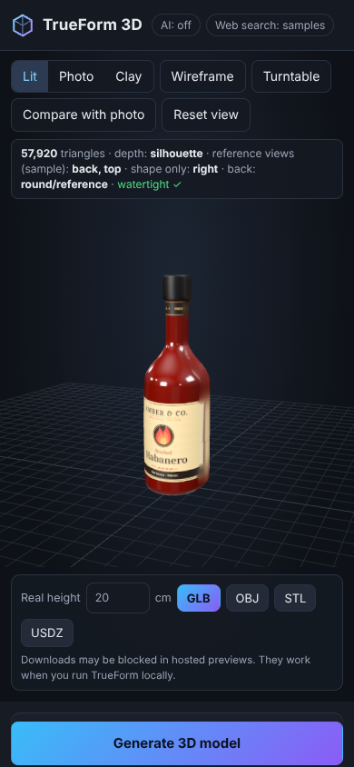
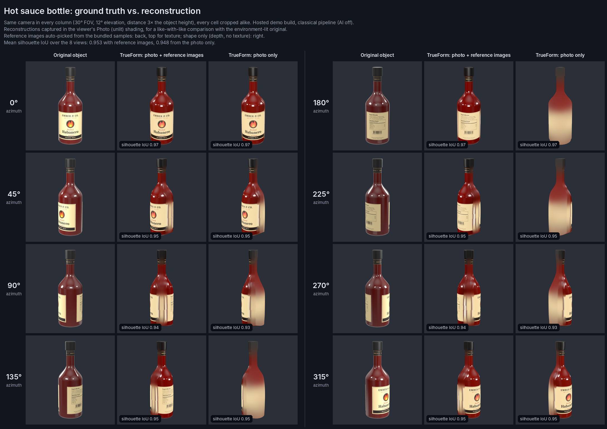
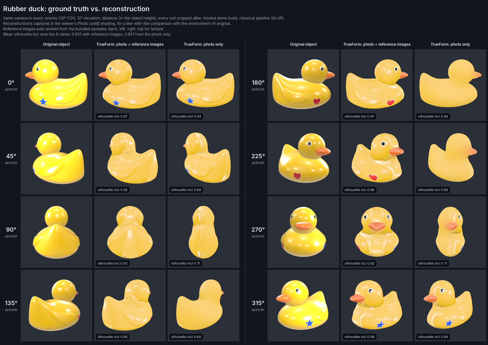

# TrueForm 3D

**Photo → 3D model that keeps your picture exact, with the hidden sides taken from real reference photos of the same object found on the web.**



*The hosted demo with its bundled hot-sauce sample. See [Demo](#demo) for what the demo does and does not show.*

## Why

Generative image-to-3D services (Tripo, Meshy and similar) re-imagine the whole object. That works for a quick asset, but the model often stops looking like the photo:

| Typical failure | What TrueForm does instead |
| --- | --- |
| Back and sides are invented, often wrong (wrong colour, missing pockets, a second face on the back of a head) | Looks for **photos of the same object from other angles on the web** (or in tabs you drag from) and copies the back and sides from those. A side view is only used for texture when TrueForm can tell which side it shows; otherwise it sets the depth only. If nothing convincing is found, it uses a neutral shape and neutral colours instead of making detail up. |
| Front texture is re-generated, so text, logos and fine print blur or change | The front of the model **is your photo**, projected pixel for pixel. Only the outermost ~5 px along the outline, and bright rim-light streaks where the surface turns away from the camera, are replaced by colour from the interior. Those pixels hold backdrop bleed and glare that would otherwise be stretched around the sides. |
| Proportions drift (too thick, too thin, warped silhouette) | The silhouette is taken from your photo's cut-out to sub-pixel accuracy. Depth comes from a depth network and, when a side view is found, **is rescaled row by row to match the side photo's real depth**. Flat bases and lids stay flat. |
| You cannot tell how close the result is | **Compare with photo** lines an orthographic camera up with the original shot and wipes between the photo and the render. |



## Demo



[Full walkthrough video (MP4, 1280×800, both samples)](docs/demo/demo.mp4). The GIF above is its hot-sauce part.

### What the hosted demo is

`npm run build:artifact` builds a static copy of the app into `artifact/`. It is an HTML fragment with its CSS inlined and relative asset paths, plus the bundled samples, about 2.4 MB in total. It runs entirely in the browser without the Node server, so it can be embedded by a locked-down host that wraps it in its own page, serves it under a sub-path with a strict Content Security Policy, and has no `/api`. All media on this page were recorded from that build, served by `tests/e2e/artifact-host.mjs`, which emulates such a host. Every request outside the demo's sub-path was blocked during the recording, and none was attempted.

It differs from the full app in three ways:

- **Classical pipeline only (AI off).**
  - Cut-out: colour key.
  - Depth: silhouette inflation (the stats read *depth: silhouette*).
  - Ranking: colour histograms.
  - The AI models (RMBG-1.4, Depth Anything V2, CLIP) are downloaded from the Hugging Face Hub, which such a host cannot reach. The AI option is therefore disabled in the demo, with a note saying why.
- **No live web search.** The badge reads *Web search: samples*. Each sample comes with 7 bundled reference images, one of them an unrelated distractor. **Generate** auto-picks from those. **Search web** only explains that live search needs the TrueForm server (`npm start`).
- **The samples are synthetic.**
  - What they are: every "photo" and reference image is a three.js studio render of one of two procedural test objects, a hot-sauce bottle and a rubber duck (`scripts/render-samples.mjs`, `scripts/sample-scene.js`). They are not real photos and not web results; the app says so under *Try a sample* and in the search status.
  - Why they are easier than real photos: a seamless plain backdrop, the exact same object in every image, consistent framing, and true side and back views. They were also tuned to the classical cut-out: the label stock was changed from cream to parchment, because the colour key removed cream labels as backdrop.
  - Expect weaker results on real photos.

The demo opens on the first sample and builds it straight away. **Try a sample → Rubber duck** loads the second; press **Generate** to build it. `?sample=<id>` (`hot-sauce`, `rubber-duck`) opens a given sample in the demo and in the full app; only the demo also generates it automatically. Exports work, but a host may block the download; the export bar says so.

| | |
| --- | --- |
|  As it opens: the photo, the ranked reference images and the model |  The back label comes from the back reference image; the side image is used for shape only |
|  Rubber duck: each side image goes to the end it shows (head-on view to the head, rear view to the tail) |  The heart on the far side comes from the back reference image |

On a phone (390×844), the toolbar and stats sit above the 3D view, and the compare and export bars sit below it, so nothing covers the model:



### Accuracy against the true objects

Because the samples are renders, the true 3D objects are known. `docs/demo/groundtruth/` holds turntable renders of them at 8 azimuths, with the camera documented in `cameras.json`. The comparison grids put each view next to the reconstruction, built with and without the reference images, from the same camera.

- **Shading:** reconstructions are shown in the viewer's *Photo* (unlit) shading. The texture already contains the photo's lighting, and the ground truth is lit by its environment only.
- **Colour:** the sample photos were rendered with studio lights and tone mapping, unlike the ground truth, so the reconstructions' colours differ from it (a brighter red bottle, a paler duck). Compare outlines and texture placement, not brightness.
- **Silhouette IoU:** 1 means an identical outline, after scaling the model to the true height (from `docs/demo/comparison.json`).

| Sample | Run | 0° | 45° | 90° | 135° | 180° | 225° | 270° | 315° | Mean |
| --- | --- | --- | --- | --- | --- | --- | --- | --- | --- | --- |
| Hot sauce | photo + reference images (back, top; side for shape only) | 0.970 | 0.949 | 0.942 | 0.949 | 0.971 | 0.949 | 0.942 | 0.949 | **0.953** |
| Hot sauce | photo only | 0.970 | 0.948 | 0.925 | 0.948 | 0.971 | 0.948 | 0.925 | 0.948 | **0.948** |
| Rubber duck | photo + reference images (back, left, right, top) | 0.974 | 0.950 | 0.915 | 0.950 | 0.974 | 0.961 | 0.920 | 0.960 | **0.951** |
| Rubber duck | photo only | 0.941 | 0.875 | 0.712 | 0.875 | 0.941 | 0.876 | 0.713 | 0.876 | **0.851** |

IoU measures only the outline. Judge the texture from the grids: [hot sauce](docs/demo/comparison-hot-sauce.png), [rubber duck](docs/demo/comparison-rubber-duck.png).





### Known limitations you can see in the demo

- **Hot sauce, sides (about 60°–120° and 240°–300°): no side image texture.**
  - The bottle's two ends have the same colours, so auto-pick cannot tell which side the side image shows. It uses that image for depth only and marks it *shape only* (stats: *shape only: right*).
  - The sides are therefore filled by stretching the edges of the photo and of the back image. On label rows this gives a cream band with thin dark vertical stripes, where the real bottle shows red glass between its two labels. It is visible on the right edge of the default view, in the video, and at 90° and 270° in the grid.
  - Clicking the *shape only* badge uses the image's texture anyway, at the risk of placing it on the wrong side.
- **Hot sauce, details.**
  - The cap top and the base are flat, but coloured uniformly from the photo just inside their outline; the top image is not used for them.
  - The photo sees the base slightly from above, so its outline is a shallow curve. The flat base follows it, and from the side its edge sits a few pixels higher than the real one.
- **Rubber duck: the shape is two layers over the photo's outline.**
  - Nothing that sticks out toward or away from the camera is modelled.
  - Head-on (270°), the beak is painted flat on the face, and the chest shows pale streaks.
  - From behind (90°), the raised tail is a broad rounded slab with faint vertical streaks.
  - At 45° and 135° the head runs into the body without the notch of the neck, and a faint vertical crease crosses the head where the front and back layers meet.
- **Baked-in highlights.** The photos' highlights are part of the texture. They stay put as the model turns, for example the bright patches on the duck's back and the glass reflections on the bottle.
- **Photo only (no reference images).** The back is a blurred tone of the front: no back label, no heart. Small decals such as the star are kept out of it. Without a side view the depth comes from silhouette inflation alone, which works for the round bottle but makes the duck far too thin: depth 0.60 of its height instead of 0.97, IoU 0.71 at 90° and 270°.

### Re-creating the demo material

```bash
npm run samples:render   # re-render public/samples/ and docs/demo/groundtruth/ (deterministic on a given machine)
npm run demo:record      # build the hosted demo, record docs/demo/* (needs ffmpeg with libx264 and python3 with Pillow; ~5 min)
```

`demo:record` runs `npm run build:artifact`, serves `artifact/` with `tests/e2e/artifact-host.mjs` on port 5191, and drives it in headless Chromium with AI off. It writes:

- `demo.mp4`, and `demo.gif` (the hot-sauce part);
- the screenshots `01-sample-loaded.png` … `05-phone.png`, `duck-model.png` and `duck-back.png`;
- the comparison grids and `comparison.json`, which holds the ranking, auto-picks, stats, sizes and IoU per azimuth.

Two environment variables help when iterating: `DEMO_SKIP_BUILD=1` reuses an existing `artifact/`, and `DEMO_KEEP_TMP=1` keeps the raw WebM and the turntable captures.

## How it works

Everything heavy runs **in your browser** (WebGPU when available, otherwise WASM). The small Node server only performs web image searches and fetches remote images on your behalf, because browsers do not allow reading pixels across origins.

1. **Cut-out.** Uses image transparency if the photo has it, then AI matting ([RMBG-1.4](https://huggingface.co/briaai/RMBG-1.4)), then a colour-key fallback for plain backdrops. The colour key models the backdrop from the frame border, removes backdrop seen through holes (mug handles), and refines edges at full resolution.
2. **Depth.** [Depth Anything V2](https://huggingface.co/onnx-community/depth-anything-v2-small) runs on a crop around the object. Its relative depth is measured against the *rim surface*, the depth along the silhouette interpolated across the object. That keeps the perspective tilt of the shot.
3. **Reference views from the web.**
   - The object is named from the file name, or from CLIP zero-shot identification. You can edit the name.
   - The server searches Wikimedia Commons and Openverse (and Google, Brave or SerpApi if you add keys) for `name`, `name back view`, `name side view` and `name top view`.
   - Results are ranked in the browser by **CLIP similarity to your photo** (colour histograms without AI), and each one's viewpoint is classified.
   - The best match for each hidden side is picked automatically when you press **Generate**. You can override every slot by hovering a result or dragging any image from another browser tab, and **⇋** mirrors a reference.
   - **Side views go to the end they show.** Each side candidate's colours are compared with the two ends of the photo's cut-out: on a duck, the beak end against the tail end. It then fills the left or the right slot. If the two ends look alike, the best side view sets the depth only and is marked **shape only**. A wrong guess would paint, say, a beak on a tail. Click the badge to use its texture anyway.
   - "Search in your own browser" opens Google, Bing, DuckDuckGo or Yandex Images in a new tab; drag images back from there.
4. **Geometry.** A closed two-layer mesh (front, back and a stitched side wall) over the silhouette.
   - The shape prior solves a Poisson equation with a correction so **every cross-section is round**: a disc becomes a sphere, a bar becomes a cylinder.
   - **Flat ends** are detected in the outline: a bottle's base or a lid, with straight walls rising from it. They keep their full thickness up to the edge and get a flat face, instead of pinching into a ridge.
   - The front adds the depth network's relief.
   - The back comes from the back photo's depth, a mirror of the front, or the prior.
   - Side and top photos rescale the front-to-back thickness per row or column.
   - Rim vertices are snapped to the cut-out's outline, and rim normals are computed analytically, so the silhouette is smooth and the seam is clean.
5. **Texture.**
   - The atlas holds the photo on the left and the back on the right.
   - The back reference is mirrored and warped row by row onto the silhouette, then gently colour-matched (exposure and white balance only).
   - Side and top references replace texels the photo only sees at grazing angles. A depth test from the reference's direction limits this to surfaces that reference can actually see. Without it, the top view would paint the duck's beak onto its chest.
   - The front/back seam takes its colour from the interior of the photo, not from its rim, and both halves share their outermost texels, so the seam shows no line.
   - Without a back reference, the back is a blurred tone of the front. Small decals and text are left out of it.

The mesh is built closed and checked after every build (the status bar shows *watertight ✓*), so STL exports go straight to a slicer.

The viewer has three shadings: **Lit** (soft studio light that keeps the photo's colours), **Photo** (unlit: the texture exactly as baked, which is what *Compare with photo* uses) and **Clay** (geometry only).

## Run it

```bash
npm install
npm run dev            # http://localhost:5173 (Vite, with the search API built in)
```

Production:

```bash
npm run build
npm start              # serves dist/ and the API on http://127.0.0.1:5173 (PORT/HOST env vars)
```

The first AI use downloads models from the Hugging Face Hub, about 250 MB in total. They are cached by the browser afterwards. Add `?ai=0` to the URL, or untick the AI option under *Shape & texture*, to use the classical pipeline only (colour key + inflation, CLIP-free ranking). Add `?sample=hot-sauce` or `?sample=rubber-duck` to open a bundled sample.

### Demo builds and scripts

| Command | What it does |
| --- | --- |
| `npm run build:demo` | Static demo build into `dist-demo/`: relative paths, so it works under any sub-path. Demo mode turns AI off, opens the first bundled sample and builds it, and explains instead of searching when there is no search server. |
| `npm run build:artifact` | `build:demo`, then `scripts/build-artifact.mjs` turns it into `artifact/`: an HTML fragment (no doctype/head/body) with the CSS inlined, relative assets, `samples/`, and no `.wasm`. It fails if a path is absolute or the sample manifest points at missing files. |
| `npm run preview:demo` | `vite preview --mode demo`: serves the `dist-demo/` build locally. The search API is still attached here, so web search works if you are online. To see the locked-down behaviour, use `node tests/e2e/artifact-host.mjs [port]` after `build:artifact` and open `http://127.0.0.1:5180/hosted/demo/`. |
| `npm run samples:render` | Renders the bundled samples (`public/samples/*.jpg` + `manifest.json`) and the ground-truth turntables (`docs/demo/groundtruth/`) in headless Chromium. `node scripts/render-samples.mjs hot-sauce` re-renders one sample. |
| `npm run demo:record` | Records the demo media in `docs/demo/` from the hosted build (see [Demo](#re-creating-the-demo-material)). |

### Better web search (optional)

Wikimedia Commons and Openverse work without keys. For broader product coverage, set any of:

| Variable | Provider |
| --- | --- |
| `BRAVE_API_KEY` | [Brave Search API](https://brave.com/search/api/) (image search) |
| `GOOGLE_CSE_KEY` + `GOOGLE_CSE_CX` | [Google Programmable Search](https://developers.google.com/custom-search/v1/overview) with image search enabled |
| `SERPAPI_KEY` | [SerpApi](https://serpapi.com/) Google Images |
| `OPENVERSE_TOKEN` | Higher Openverse rate limits |

### Exports

| Format | Notes |
| --- | --- |
| GLB | Textured (JPEG atlas). Scaled to the *Real height* you enter, in metres. The material is unlit when the viewer is in *Photo* mode. |
| OBJ | Zip with `model.obj`, `model.mtl` and `texture.jpg`. |
| STL | Watertight, in millimetres, for 3D printing. |
| USDZ | For AR Quick Look on iPhone, iPad and Mac. |

## Tips for the best result

- Use a sharp photo with the whole object in frame, ideally on a plain background. With the classical cut-out, large white or cream areas close to the backdrop colour can be removed along with it; try a lower *Backdrop tolerance* or the AI matting.
- Give the object's exact name ("Nike Air Max 90 white", not "shoe"). Better names find better reference views.
- Check the picked reference views: the same product and colourway, and upright. Use **⇋** if a side view faces the wrong way. If it shows the other end of the object, hover the result and use **Use as left** / **Use as right** instead; click a slot's **shape only** badge to use its texture.
- *Shape & texture* has live controls for thickness, depth relief, roundness, back shape and back texture. The model rebuilds as you drag.

## Limitations

- This is a reconstruction, not a generative model. The two-layer representation cannot hold parts hidden behind other parts in the photo, such as the inside of a cup or an arm behind the body. It also cannot hold parts pointing at the camera, such as a beak seen head-on. Those surfaces close smoothly instead.
- The back can only be as good as the reference photo found. Reference photos are assumed upright and roughly aligned with the main photo's framing (they are fitted by their silhouette's height and row extents).
- Side views are placed by colour. When both ends of an object share the same colours, a side view only sets the depth unless you choose otherwise, and those sides show the stretched seam colour.
- Flat ends are detected conservatively. Tapered walls (flower pots), thin feet (a wine glass) and very flat objects (a tuna can) keep a rounded, pinched edge.
- Highlights in the photos are baked into the texture.
- Model choices are configurable under *Shape & texture*. RMBG-1.4 is licensed for non-commercial use; switch the matting model for commercial work. Depth Anything V2 Small is Apache-2.0 and CLIP is MIT.

## Development

```bash
npm test              # unit tests (geometry, flat ends, segmentation, texture exactness and seams, side-view placement,
                      # search/proxy security, sample manifest, artifact page, exporters)
npm run test:e2e      # Playwright: full flow with mocked web search, exports, offline AI fallback, mobile layout,
                      # bundled samples, and the hosted artifact behind tests/e2e/artifact-host.mjs (ports 5179/5180)
npm run typecheck
```

```
server/            Node: web image search providers, SSRF-safe image proxy, static server
src/core/          Pure TypeScript reconstruction (runs in a worker): segmentation, Poisson inflation, flat ends,
                   depth relief, reference alignment, two-layer mesh, texture atlas
src/ml/            transformers.js worker (depth, matting, CLIP) with WebGPU→WASM fallback
src/search/        Identification, ranking, side-view placement, auto-picking, bundled samples
src/viewer/        three.js viewer with photo-matched comparison
src/export/        GLB / OBJ+MTL / STL / USDZ writers
scripts/           Sample renderer, artifact builder, demo recorder
docs/demo/         Demo media, ground-truth renders and comparison grids
```

`window.__trueform` exposes the app state, `ready` (resolves once the page has finished opening), `loadSample` and the `viewer`. The viewer offers `setOrbit`, `setOrbitTarget`, `setFov`, `setBackground`, `setGridVisible`, `bounds` and `screenshot`, for tests and recordings.
