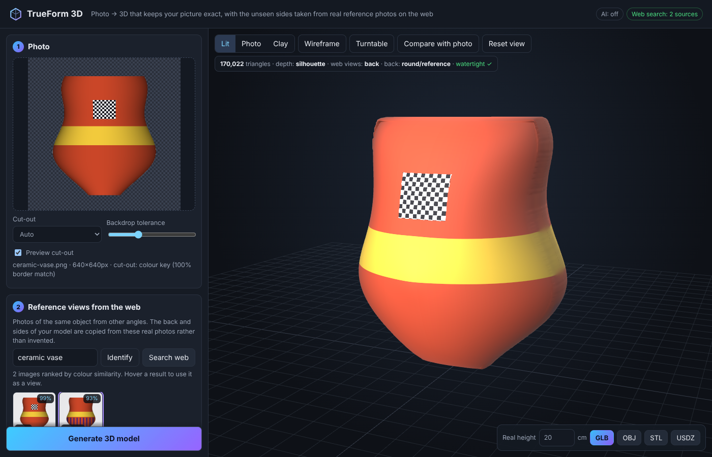
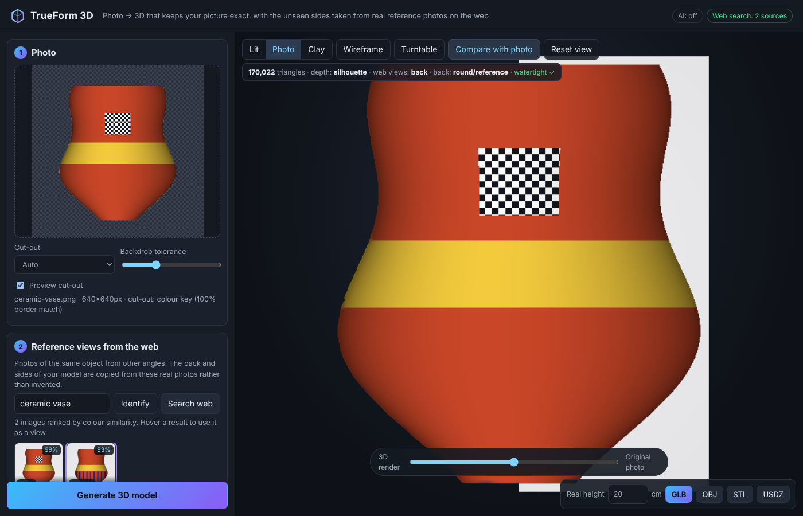

# TrueForm 3D

**Photo → 3D model that keeps your picture exact, with the hidden sides taken from real reference photos of the same object found on the web.**



## Why

Generative image-to-3D services (Tripo, Meshy and similar) re-imagine the whole object. That works for a quick asset, but the model often stops looking like the photo:

| Typical failure | What TrueForm does instead |
| --- | --- |
| Back and sides are invented, often wrong (wrong colour, missing pockets, a second face on the back of a head) | Looks for **photos of the same object from other angles on the web** (or in tabs you drag from) and copies the back and sides from those. If nothing convincing is found, it uses a neutral shape and neutral colours instead of making detail up. |
| Front texture is re-generated, so text, logos and fine print blur or change | The front of the model **is your photo**, projected pixel for pixel. Only a ~2 px rim is cleaned of background bleed. |
| Proportions drift (too thick, too thin, warped silhouette) | The silhouette is taken from your photo's cut-out to sub-pixel accuracy. Depth comes from a depth network and, when a side view is found, **is rescaled row by row to match the side photo's real depth**. |
| You cannot tell how close the result is | **Compare with photo** lines an orthographic camera up with the original shot and wipes between the photo and the render. |



## How it works

Everything heavy runs **in your browser** (WebGPU when available, otherwise WASM). The small Node server only performs web image searches and fetches remote images on your behalf, because browsers do not allow reading pixels across origins.

1. **Cut-out.** Uses image transparency if the photo has it, then AI matting ([RMBG-1.4](https://huggingface.co/briaai/RMBG-1.4)), then a colour-key fallback for plain backdrops. The colour key models the backdrop from the frame border, removes backdrop seen through holes (mug handles), and refines edges at full resolution.
2. **Depth.** [Depth Anything V2](https://huggingface.co/onnx-community/depth-anything-v2-small) runs on a crop around the object. Its relative depth is measured against the *rim surface*, the depth along the silhouette interpolated across the object. That keeps the perspective tilt of the shot.
3. **Reference views from the web.**
   - The object is named from the file name, or from CLIP zero-shot identification. You can edit the name.
   - The server searches Wikimedia Commons and Openverse (and Google, Brave or SerpApi if you add keys) for `name`, `name back view`, `name side view` and `name top view`.
   - Results are ranked in the browser by **CLIP similarity to your photo** (colour histograms without AI), and each one's viewpoint is classified.
   - The best match for each hidden side is picked automatically when you press **Generate**. You can override every slot by hovering a result or dragging any image from another browser tab, and **⇋** mirrors a reference.
   - "Search in your own browser" opens Google, Bing, DuckDuckGo or Yandex Images in a new tab; drag images back from there.
4. **Geometry.** A closed two-layer mesh (front, back and a stitched side wall) over the silhouette.
   - The shape prior solves a Poisson equation with a correction so **every cross-section is round**: a disc becomes a sphere, a bar becomes a cylinder.
   - The front adds the depth network's relief.
   - The back comes from the back photo's depth, a mirror of the front, or the prior.
   - Side and top photos rescale the front-to-back thickness per row or column.
   - Rim vertices are snapped to the cut-out's outline, and rim normals are computed analytically, so the silhouette is smooth and the seam is clean.
5. **Texture.**
   - The atlas holds the photo on the left and the back on the right.
   - The back reference is mirrored and warped row by row onto the silhouette, then gently colour-matched (exposure and white balance only).
   - Side and top references replace texels the photo only sees at grazing angles.
   - The front/back seam is blended so it carries no stretched streaks.

The mesh is built closed and checked after every build (the status bar shows *watertight ✓*), so STL exports go straight to a slicer.

## Run it

```bash
npm install
npm run dev            # http://localhost:5173 (Vite, with the search API built in)
```

Production:

```bash
npm run build
npm start              # serves dist/ and the API on http://127.0.0.1:5173 (PORT/HOST env vars)
```

The first AI use downloads models from the Hugging Face Hub, about 250 MB in total. They are cached by the browser afterwards. Add `?ai=0` to the URL, or untick the AI option under *Shape & texture*, to use the classical pipeline only (colour key + inflation, CLIP-free ranking).

### Better web search (optional)

Wikimedia Commons and Openverse work without keys. For broader product coverage, set any of:

| Variable | Provider |
| --- | --- |
| `BRAVE_API_KEY` | [Brave Search API](https://brave.com/search/api/) (image search) |
| `GOOGLE_CSE_KEY` + `GOOGLE_CSE_CX` | [Google Programmable Search](https://developers.google.com/custom-search/v1/overview) with image search enabled |
| `SERPAPI_KEY` | [SerpApi](https://serpapi.com/) Google Images |
| `OPENVERSE_TOKEN` | Higher Openverse rate limits |

### Exports

| Format | Notes |
| --- | --- |
| GLB | Textured (JPEG atlas). Scaled to the *Real height* you enter, in metres. The material is unlit when the viewer is in *Photo* mode. |
| OBJ | Zip with `model.obj`, `model.mtl` and `texture.jpg`. |
| STL | Watertight, in millimetres, for 3D printing. |
| USDZ | For AR Quick Look on iPhone, iPad and Mac. |

## Tips for the best result

- Use a sharp photo with the whole object in frame, ideally on a plain background.
- Give the object's exact name ("Nike Air Max 90 white", not "shoe"). Better names find better reference views.
- Check the picked reference views: the same product and colourway, and upright. Use **⇋** if a side view faces the wrong way.
- *Shape & texture* has live controls for thickness, depth relief, roundness, back shape and back texture. The model rebuilds as you drag.

## Limitations

- This is a reconstruction, not a generative model. The two-layer representation cannot hold parts hidden behind other parts in the photo, such as the inside of a cup or an arm behind the body. Those surfaces close smoothly instead.
- The back can only be as good as the reference photo found. Reference photos are assumed upright and roughly aligned with the main photo's framing (they are fitted by their silhouette's height and row extents).
- Model choices are configurable under *Shape & texture*. RMBG-1.4 is licensed for non-commercial use; switch the matting model for commercial work. Depth Anything V2 Small is Apache-2.0 and CLIP is MIT.

## Development

```bash
npm test              # unit tests (geometry, segmentation, texture exactness, search/proxy security, exporters)
npm run test:e2e      # Playwright: full flow with mocked web search, exports, offline AI fallback, mobile layout
npm run typecheck
```

```
server/            Node: web image search providers, SSRF-safe image proxy, static server
src/core/          Pure TypeScript reconstruction (runs in a worker): segmentation, Poisson inflation,
                   depth relief, reference alignment, two-layer mesh, texture atlas
src/ml/            transformers.js worker (depth, matting, CLIP) with WebGPU→WASM fallback
src/search/        Identification, ranking and auto-picking of reference views
src/viewer/        three.js viewer with photo-matched comparison
src/export/        GLB / OBJ+MTL / STL / USDZ writers
```
