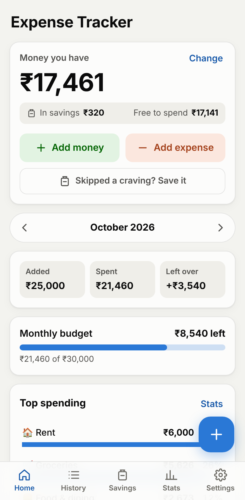
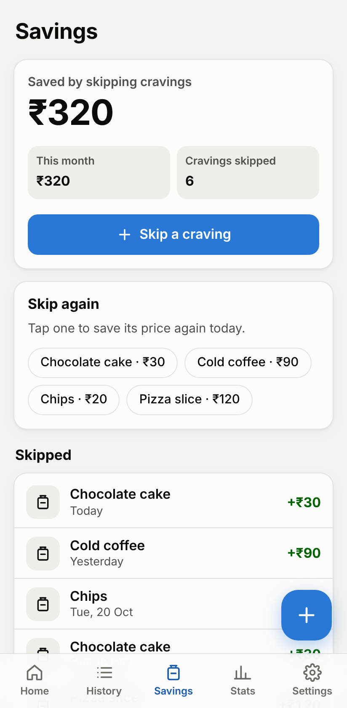
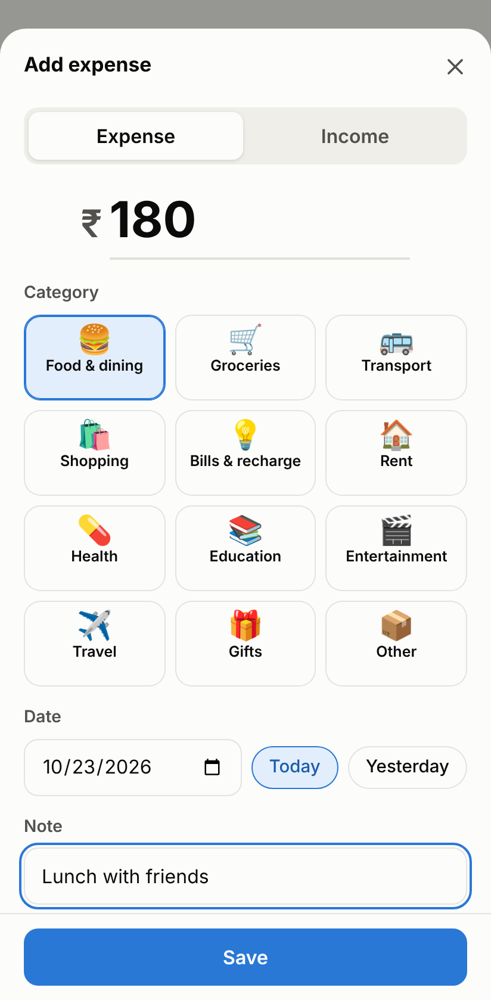
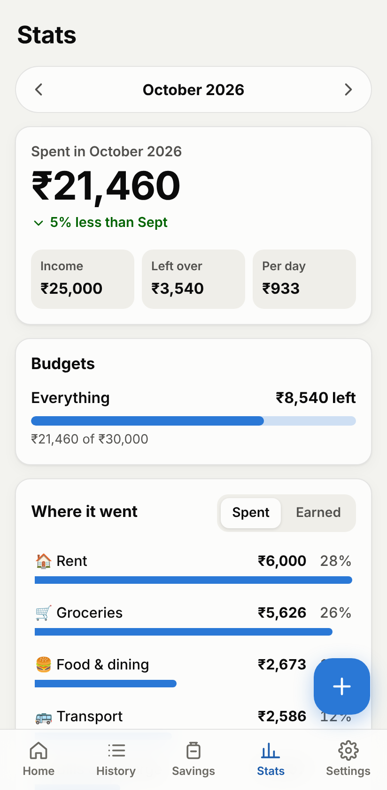
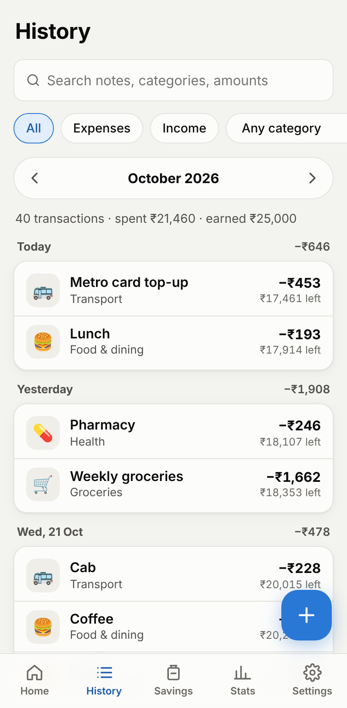
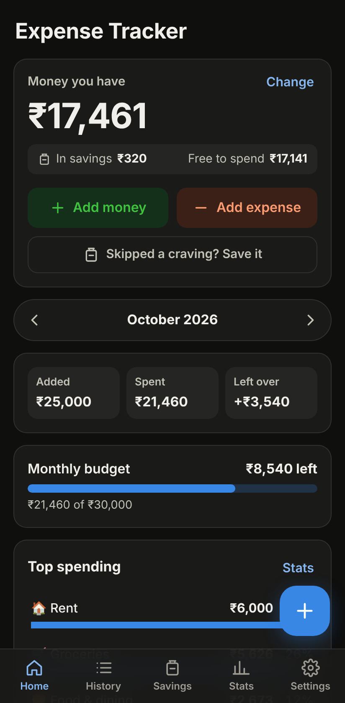

# Expense Tracker

Track what you spend and earn, from your phone. It works offline, has no account and no ads, and your data never leaves the device.

<p>
  
  
  
  
  
  
</p>

## Get it on your phone

### Android: install the APK

1. On your phone, open
   **<https://github.com/lakshmang007/claude/releases/download/expense-tracker-latest/expense-tracker.apk>**
   (or the [release page](https://github.com/lakshmang007/claude/releases/tag/expense-tracker-latest)).
2. Open the downloaded `expense-tracker.apk`. The first time, Android asks you to allow installs from your browser or Files app. Allow it, go back, and tap **Install**.
3. Open **Expense Tracker** from your app drawer.

Every push that changes `expense-tracker/` rebuilds the APK ([workflow](../.github/workflows/expense-tracker.yml)) and replaces that release. To update, install the new APK over the old one. Your data stays.

### iPhone or Android: install the web app

The same app runs in the browser and installs to the home screen. It is published to GitHub Pages once this folder is on the default branch and Pages is switched on (one time: **Settings → Pages → Build and deployment → Source: GitHub Actions**). Then:

1. Open **<https://lakshmang007.github.io/claude/expense-tracker/>** on your phone.
2. **iPhone (Safari):** tap **Share**, then **Add to Home Screen**.
   **Android (Chrome):** tap **Install app** in the app's Settings tab, or **⋮ → Add to Home screen**.

After the first visit it opens with no connection.

## What it does

- **Money you have:** set how much you have once. **Add money** raises it, every **Add expense** lowers it, and each entry in the list shows what was left after it. Counted your cash and it differs? Tap **Change** and type the real amount; your entries stay as they are.
- **Savings from skipped cravings:** wanted a ₹30 chocolate cake and didn't buy it? Tap **Skipped a craving?** and that ₹30 counts as saved. Home shows how much of your money is in savings and how much is free to spend, and the Savings tab lists what you skipped, with one-tap buttons for the things you skip often.
- **Add an expense or money in a few taps:** amount, category, date (with Today and Yesterday shortcuts) and an optional note. Tap any entry to edit or delete it; a deleted entry can be brought back with **Undo**.
- **Home:** the money you have, then the month's money in, spending and what is left over, a budget bar, top spending categories and recent entries. Use the arrows to move between months.
- **History:** every entry grouped by day, with search (notes, categories, amounts) and filters by type, category, month or all time.
- **Stats:** total spent with the change from last month, income, what was left over and spending per day; spending or income by category; the last six months as a chart and a table.
- **Budgets:** a monthly limit and optional limits per category. The bar turns amber at 80% and red when you go over, with a label saying so.
- **Categories:** 19 built in, with emoji. Rename, change the icon, add your own or delete them. Entries from a deleted category move to "Other".
- **Your data:** back up to a file and restore it (on a new phone, for example), or export a CSV for Excel or Google Sheets (with the balance after each entry). In the Android app these open the share sheet, so you can save to Files or Drive or send the file to yourself.
- **Any currency:** it guesses from your phone's time zone and language (₹ in India), and you can change it in Settings. Changing it only changes the symbol; amounts are not converted.
- Light and dark theme (follows the phone, or pick one), and the phone's Back button closes sheets before it leaves the app.

## Your data

Everything is stored on the device: in the app's storage for the APK, in the browser's storage for the web app. The APK and the web app don't share data, even on the same phone. Nothing is uploaded anywhere.

Uninstalling the app (or clearing the browser's site data) deletes your entries. **Back up** in Settings makes a `.json` file you can **Restore** from later, on this phone or another one.

## Develop

Needs Node.js 22 or newer.

```bash
cd expense-tracker
npm install
npm run dev          # http://localhost:5173 (add -- --host to open it from a phone on the same Wi-Fi)
npm run typecheck
npm test             # unit tests (Vitest)
npm run test:e2e     # the built app in an emulated Pixel 7 (Playwright)
npm run build        # static site in dist/
npm run build:demo   # one self-contained page, dist-demo/expense-tracker.html, for an online preview
```

Build the APK on your computer (needs Android Studio, or the Android SDK and JDK 21):

```bash
npm run android:apk  # → android/app/build/outputs/apk/debug/app-debug.apk
npx cap open android # or open the project in Android Studio
```

`npm run icons` re-renders the app icon, the web icons and the Android launcher and splash images from the SVG in `scripts/make-icons.mjs`.

### How it is put together

| Part | What it is |
| --- | --- |
| `src/` | React 19 + TypeScript, bundled by Vite. No UI library; charts are SVG. |
| `src/lib/` | Amount parsing and formatting, dates, storage with validation, totals and filters, CSV. Unit-tested in `tests/unit/`. |
| `vite.config.ts` | Also writes `sw.js`, the service worker that caches every built file so the web app opens offline. |
| `public/manifest.webmanifest` | Makes the web app installable. |
| `android/` | The Android app made with [Capacitor](https://capacitorjs.com/): a native shell around the same web build. |

Amounts are stored as whole hundredths (₹12.50 is `1250`), so totals never pick up floating-point errors.

### About the signing key

`android/app/expense-tracker.keystore` (password `android`) is committed on purpose: every APK built from this repository is signed the same way, so a new build installs over the old one without losing data. Because the key is public, anyone could sign an APK that installs over yours, so only install builds from this repository's releases. Before publishing to the Play Store, create your own key and keep it out of the repository.
