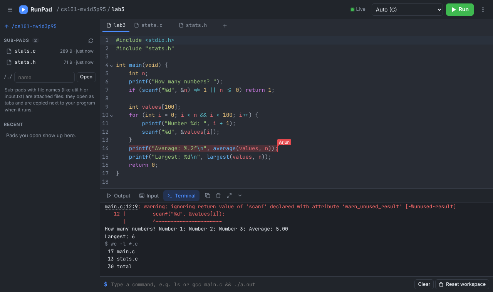
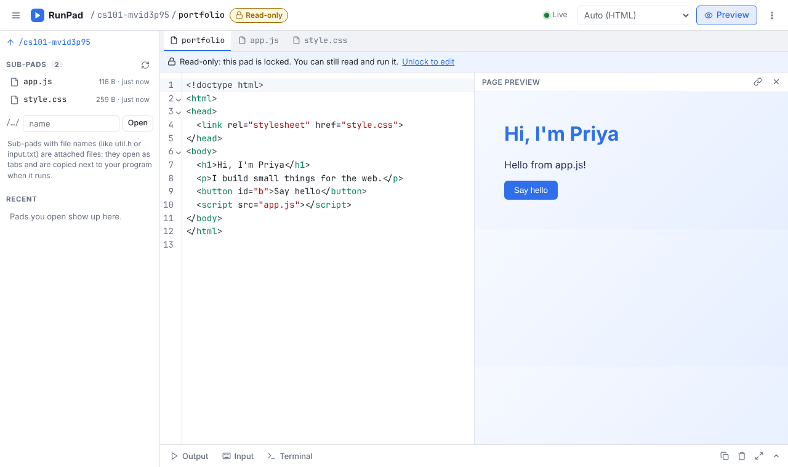
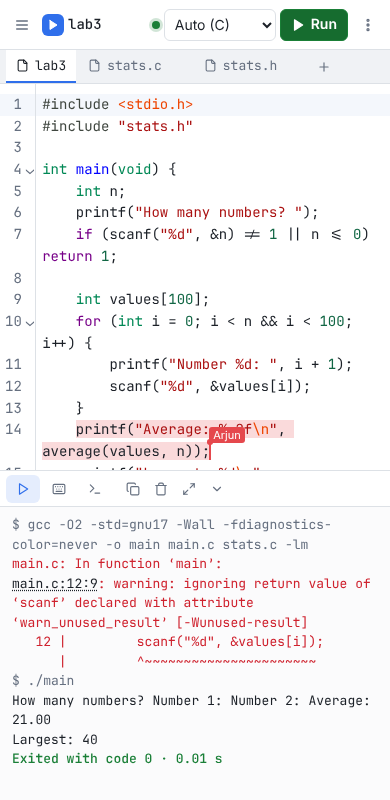

# RunPad

**A Dontpad-style shared notepad that also runs your code.** Open any address, such as `yourserver/cs101/lab3`, and start typing. Everything is saved as you type and shared live with everyone who opens the same address. There are no accounts. On top of that, RunPad can compile and run programs (with input), has a terminal, keeps version history, and can lock pads with a password.


*A 90-second walkthrough recorded from a real server ([MP4](docs/demo.mp4)).*

## RunPad compared with Dontpad

| | Dontpad | RunPad |
| --- | --- | --- |
| Any URL is a pad, no sign-up, saves as you type | ✓ | ✓ |
| Sub-pads (`/class/lab1`, `/class/lab2`) listed on the page | ✓ | ✓ In the sidebar, with sizes and times |
| Several people typing at once | Last save wins, so edits can be lost | Live merging (CRDT): no lost keystrokes, even after going offline. You can see each other's cursors and names. |
| Code editor | Plain textarea | Syntax highlighting for 18 languages, line numbers, auto-indent, bracket matching, find & replace, multiple cursors |
| **Run code** | ✗ | Python, C, C++, Java, JavaScript, TypeScript, Go, Rust, Ruby, PHP, Perl, Lua and Bash. Whichever of these the server has installed. |
| **Program input** | ✗ | Type into the running program, or prepare the input in the Input tab |
| **Terminal** | ✗ | Run shell commands in the pad's own workspace on the server |
| Multi-file programs | ✗ | Attach `util.h`, `helper.py` or `input.txt` to a pad; they open as tabs and sit next to your program when it runs |
| Clickable errors | ✗ | `main.c:7:12` in compiler or runtime output jumps to that line |
| Version history | ✗ | Automatic snapshots, a diff against now, and one-click restore |
| Password lock | ✗ | Read-only (others can view and run) or private. The lock covers sub-pads too. |
| Live preview | ✗ | Markdown, plus HTML/CSS/JS pages in a sandboxed frame |
| Download | ✗ | The file itself, or the pad with all its sub-pads as a .zip |
| Command line | ✓ | `curl` to read, `curl --data-binary @file` to save, `?append` to add lines |
| Dark mode, phone layout | ✗ | ✓ |

| Terminal (dark theme) | HTML preview of a locked pad |
| --- | --- |
|  |  |



## Quick start

Requires Node.js 20 or newer on Linux. Code execution needs the compilers and interpreters you want to offer; RunPad finds the installed ones at startup.

```bash
cd runpad
npm install
npm run build
npm start            # http://localhost:3000 and your LAN address
```

Other computers on the same network can use the LAN address the server prints, for example `http://192.168.1.20:3000/cs101`.

For development, `npm run dev` serves the app through Vite with hot reload on the same port.

### Docker

The image includes all supported toolchains:

```bash
docker build -t runpad .
docker run -d --name runpad -p 3000:3000 -v runpad-data:/data runpad
```

Pads are kept in the `/data` volume. Programs run as an unprivileged `runner` user that cannot read `/data`.

## Using it

- **Pads.** Any path is a pad, and the path is case-sensitive. `/` is the home page. Names starting with `_` are reserved at the top level.
- **Sub-pads.** `/cs101/lab3` is a sub-pad of `/cs101`. The sidebar (☰, or Ctrl+B) lists a pad's sub-pads and your recent pads.
- **Language.** Language detection is automatic: it uses the pad's file extension (`/x/prog.c`) and otherwise guesses from the code. You can pick one from the menu; the choice is shared with everyone on the pad. On an empty pad you can start from a small sample program.
- **Run** (Ctrl+Enter):
  - Compiler errors appear in the Output tab, and their `file:line` references are links to the editor.
  - If the **Input** tab is empty, the program runs interactively: type into the line under the output and press Enter. Ctrl+D ends the input.
  - If the Input tab has text, that text is the program's input and the program runs without waiting.
  - The Input tab is saved with the pad, so a teacher can leave test input there.
- **Attached files.** **+** in the tab bar creates or uploads a file such as `stats.c`, `util.h`, `helper.py` or `data.txt`. It is stored as a sub-pad (`/cs101/lab3/stats.c`) and copied next to the main program for every run:
  - C and C++ compile every attached `.c`/`.cpp` file with the main one.
  - Java compiles every `.java` file.
  - Python can `import helper`.
  - Any program can open `data.txt`.
- **Terminal** (Ctrl+\`):
  - Commands run on the server in a workspace that belongs to the pad. Files you create there stay between commands; idle workspaces are deleted after a day.
  - Before each command, the pad is saved there as `main.c` (or `prog1.c`, `Main.java`…) with its attached files.
  - While a command runs, what you type goes to its input, and Ctrl+C stops it.
  - It is not a full terminal emulator, so full-screen programs like `vim` will not work.
- **History.** ⋮ → Version history. Snapshots are taken every couple of minutes while a pad changes, and before its text is replaced wholesale (restore, upload, sample program, curl). Each one shows a diff against the current text, and you can restore any of them.
- **Locks.** ⋮ → Lock with password:
  - *Read-only*: anyone can read and run the pad, but editing needs the password.
  - *Private*: reading needs the password too.
  - A lock covers every sub-pad below it. Unlocking is remembered on that browser.
  - Forgotten passwords cannot be recovered.
- **Previews.** Markdown pads show a rendered preview. HTML pads show the live page; its relative links (`style.css`, `app.js`) load the pad's attached files.

### From the command line

```bash
curl http://localhost:3000/cs101/lab3                         # print a pad
curl --data-binary @main.c http://localhost:3000/cs101/lab3   # replace it with a file
echo "done" | curl --data-binary @- "http://localhost:3000/log?append"
curl -OJ "http://localhost:3000/cs101/lab3?download"          # save as lab3.c
curl -OJ http://localhost:3000/_api/zip/cs101                 # pad + sub-pads as a zip
```

Locked pads need a token: add `-H "X-Pad-Tokens: <token>"`. A browser gets a token when you unlock the pad, and the server returns one when you create a lock.

## Configuration

All settings are environment variables. The defaults suit a single machine or a lab network.

| Variable | Default | Meaning |
| --- | --- | --- |
| `PORT`, `HOST` | `3000`, `0.0.0.0` | Where to listen |
| `RUNPAD_DATA` | `runpad/data` | Where pads, history and the signing key are stored |
| `RUNPAD_WORK` | `$TMPDIR/runpad` | Scratch space for runs, terminal workspaces and build caches |
| `RUNPAD_MAX_PAD_KB` | `1024` | Largest pad |
| `RUNPAD_SNAPSHOT_SECONDS`, `RUNPAD_HISTORY_ENTRIES`, `RUNPAD_HISTORY_MB` | `120`, `50`, `8` | History frequency and size per pad |
| `RUNPAD_EXEC` | on | `off` turns off running code and the terminal |
| `RUNPAD_TERMINAL` | on | `off` turns off only the terminal |
| `RUNPAD_EXEC_TOKEN` | none | A run key. People must enter it once per browser to run code. Recommended on any server others can reach. |
| `RUNPAD_LANGUAGES` | all found | Comma-separated language ids to offer, e.g. `python,c,cpp,java` |
| `RUNPAD_SANDBOX` | `auto` | `auto` uses namespace isolation when the kernel allows it; `unshare` requires it; `none` uses plain processes |
| `RUNPAD_EXEC_UID`, `RUNPAD_EXEC_GID` | `65534` if the server runs as root | User that programs run as |
| `RUNPAD_RUN_TIMEOUT` | `15` | Wall-clock seconds for a run with prepared input |
| `RUNPAD_INTERACTIVE_TIMEOUT` | `300` | Wall-clock seconds while waiting for typed input, and for terminal commands |
| `RUNPAD_COMPILE_TIMEOUT` | `30` | Seconds for compiling |
| `RUNPAD_CPU_SECONDS` | `10` | CPU time per program |
| `RUNPAD_MEMORY_MB` | `512` | Address-space limit (not applied to Java, JavaScript and Go, which have their own heap limits) |
| `RUNPAD_FILE_MB`, `RUNPAD_MAX_OUTPUT_KB` | `16`, `512` | Largest file a program may write, and the most output it may print |
| `RUNPAD_MAX_PROCS` | `128` | Process limit, applied when programs run as their own user |
| `RUNPAD_MAX_CONCURRENT`, `RUNPAD_MAX_PER_CLIENT`, `RUNPAD_RUNS_PER_MINUTE` | `6`, `2`, `40` | Load limits |
| `RUNPAD_WORKSPACE_MB`, `RUNPAD_WORKSPACE_IDLE_HOURS` | `64`, `24` | Terminal workspace size and lifetime |
| `RUNPAD_TRUST_PROXY` | off | `1` takes the client IP from `X-Forwarded-For` (behind a reverse proxy) |

Behind nginx, pass WebSockets through:

```nginx
location / {
    proxy_pass http://127.0.0.1:3000;
    proxy_http_version 1.1;
    proxy_set_header Upgrade $http_upgrade;
    proxy_set_header Connection "upgrade";
    proxy_set_header Host $host;
    proxy_set_header X-Forwarded-For $proxy_add_x_forwarded_for;
}
```

## Security

Like Dontpad, **anyone who knows a pad's address can read and change it** unless it is locked. Don't put secrets in open pads.

Running code is running other people's programs on your server. RunPad applies these protections to every run and terminal command:

- **Resource limits.** CPU time, wall-clock time, memory, file size, output size and number of processes are capped. A program's whole process group is killed when it ends or is stopped.
- **Clean environment.** Programs get a fresh environment with none of the server's variables. HOME and TMPDIR point to their own directory.
- **Never root.** If the server runs as root, programs run as `nobody` (or `RUNPAD_EXEC_UID`). The data directory is only readable by the server.
- **Isolation**, when the kernel allows unprivileged user namespaces, as most Linux distributions do and the startup log says:
  - each run gets its own network namespace, so there is no network;
  - its own PID namespace and `/proc`, so it cannot see or signal other programs;
  - and a mount namespace in which the data directory is replaced by an empty one.
- **Previews.** HTML previews are served with `Content-Security-Policy: sandbox`, so a page's scripts cannot reach RunPad or your browser's stored unlock tokens.
- **Locks.** Lock passwords are hashed with scrypt; tokens are HMAC-signed and stop working when the lock changes. Unlock attempts are rate-limited.

What this does **not** protect against:

- **Your user's own files.** When the server runs as your own user without `RUNPAD_EXEC_UID`, programs can read files your account can read. Only trusted people should run code on such a setup. For anything else:
  - use the Docker image;
  - or start RunPad as root with `RUNPAD_EXEC_UID` set to a dedicated account;
  - and set `RUNPAD_EXEC_TOKEN`.
- **Kernel exploits.** These are processes, not virtual machines.
- **Docker without isolation.** Docker's default seccomp profile normally blocks the namespace isolation, so RunPad falls back to plain processes as the `runner` user. The startup log says which mode is active. Programs then have network access and can see other running programs. If that matters, run the container on an isolated network or under gVisor (`--runtime=runsc`).
- **The shared Go build cache.** It is used by everyone's runs.

## Development

```bash
npm run dev          # server + Vite with hot reload
npm run typecheck
npm test             # unit and integration tests (vitest): storage, locks, sync, HTTP API, sandboxed runs
npm run test:e2e     # builds, then drives the app in Chromium with Playwright
```

How it fits together:

| Path | What it does |
| --- | --- |
| `server/index.js` | HTTP server and static files. It routes WebSocket upgrades and runs Vite as middleware in dev mode. |
| `server/store.js` | Pads as Yjs documents on disk, the sub-pad index, history, locks |
| `server/collab.js` | Live sync (the y-websocket protocol plus permission messages) |
| `server/api.js` | `/_api` endpoints: raw text, history, locks, zip, preview |
| `server/exec.js`, `server/sandbox.js`, `server/languages.js` | Running code and terminal commands |
| `shared/` | Pad path rules, the language table and detection, text replacement (shared by the server and the browser) |
| `src/` | The browser app: CodeMirror 6 editor, sync client, panels, dialogs |
